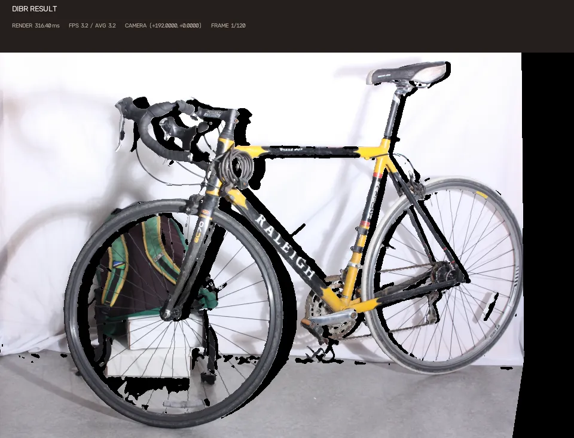
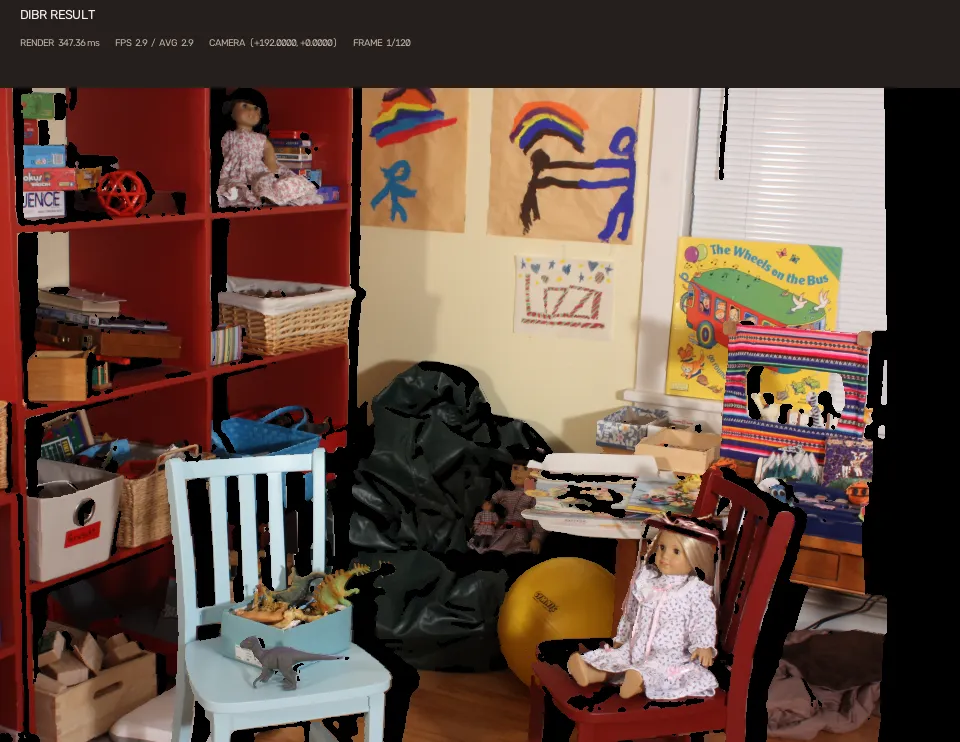
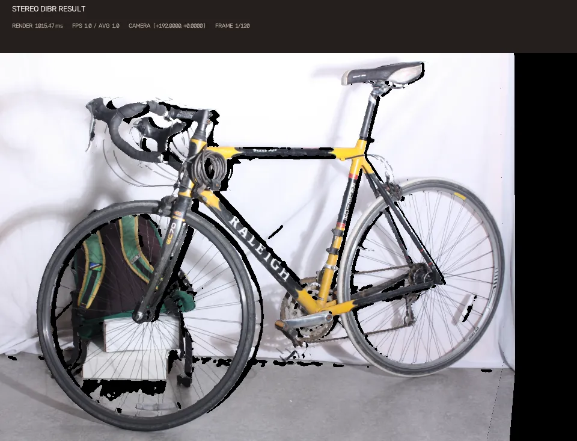
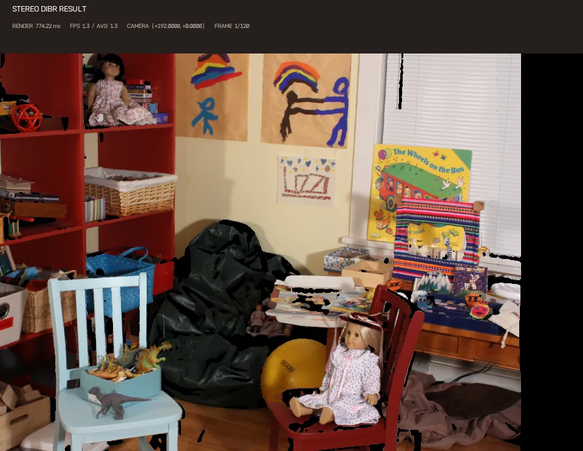

# DIBR Legacy

A Python reimplementation of my legacy MATLAB DIBR (Depth Image-Based Rendering) project.

My original MATLAB implementation: [matlab_dibr_test](https://github.com/whdlgp/matlab_dibr_test)

## Dataset

Download the Middlebury Stereo 2014 dataset from the [official website](https://vision.middlebury.edu/stereo/data/scenes2014/).

Place the downloaded files in the following directory structure:

```text
middlebury2014/
├── Bicycle1-perfect/
│   ├── calib.txt
│   ├── im0.png
│   ├── im1.png
│   ├── disp0.pfm
│   └── disp1.pfm
└── Playroom-perfect/
    ├── calib.txt
    ├── im0.png
    ├── im1.png
    ├── disp0.pfm
    └── disp1.pfm
```

Dataset reference:  
Scharstein et al., *High-resolution stereo datasets with subpixel-accurate ground truth*, GCPR 2014.

## Setup

This project uses [uv](https://docs.astral.sh/uv/).

```bash
uv sync
```

## Run

Single-camera virtual viewpoint rendering demo:

```bash
uv run demo_single_camera.py
```

Stereo-camera midpoint rendering demo:

```bash
uv run demo_stereo_camera.py
```

## Result

Animated WebP demos.

<details>
<summary>Single-camera virtual viewpoint rendering</summary>





</details>

<details>
<summary>Stereo-camera midpoint rendering</summary>





</details>

## License

The source code is licensed under the MIT License.

Demo outputs are generated using the Middlebury Stereo 2014 dataset
and are not covered by the source code license.

Dataset: [Middlebury Stereo 2014](https://vision.middlebury.edu/stereo/data/scenes2014/)